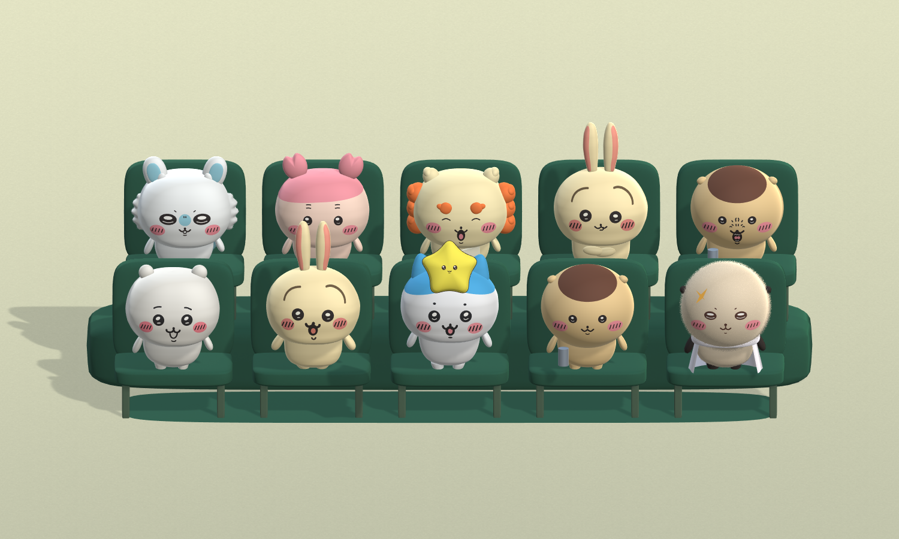

# Mid — 인형 관중석 인터랙션

## 현재 제출용 상태
- Unity **6000.6.0f1**에서 이 `Mid` 폴더를 프로젝트로 엽니다.
- 최신 씬: `Assets/Mid/Scenes/Mid_EightFriendsAudience.unity`
- 재생 후 마우스로 별을 움직이면 인형들이 서로 다른 속도로 고개를 돌립니다. Space: 자동 이동 전환, R: 초기화.
- 총 **10마리, 2줄 5석**: 8종 기본 버전과 우사기 팔짱/닫힌 입, 쿠리만쥬 추가 표정. 동일 캐릭터·동일 표정의 중복을 제거했습니다.
- 랏코: 작은 귀, 원형에 가까운 얼굴, 긴 얼굴 털. 쿠리만쥬: 원형 머리 무늬, 작은 귀, 원형 눈과 조정한 열린 입.
- 관중석 중복 검사 및 10마리 상하좌우·대각선 추적 검증 통과.

Unity 캐시와 임시 파일, 프레임 녹화 폴더는 저장소에서 제외합니다. 아래는 작업 과정 기록이며 이전 인원수·씬에 대한 설명도 포함되어 있습니다.

---

# Little Spectators — 인형 관중석

이 Mid 폴더 자체가 **Unity 6000.6.0f1** 프로젝트입니다.

## 실행

1. Unity Hub의 Add project from disk에서 이 Mid 폴더를 선택합니다.
2. **Assets/Mid/Scenes/Mid_PlushAudience.unity**를 엽니다.
3. Play를 누르고 Game 화면에서 마우스를 움직입니다. 포커스가 없으면 Game 탭을 한 번 클릭합니다.

- 마우스: 공의 좌우·상하 이동. 9마리가 각자의 위치에서 공을 바라봅니다.
- Space: 자동 왕복·상하 시연 켜기/끄기.
- R: 공과 머리 자세를 초기화. 자동 시연 중에는 다음 프레임에 자동 이동이 이어집니다.
- 화면 밖 커서: 마지막 목표 위치 유지.

## 구현 내용

- 곰·토끼·강아지 각각 3마리, 총 9마리. 3줄 계단식 초록 관중석.
- 토끼는 긴 귀와 밝은 털, 강아지는 처진 갈색 귀와 큰 주둥이로 구분합니다.
- 몸은 고정하고 목만 좌우 및 위아래로 움직입니다. 두 회전을 조합해 대각선도 추적합니다.
- 직접 계산한 Y축·X축 회전 행렬을 조합합니다. 좌우 48도, 위 35도, 아래 30도로 제한합니다.
- 인형별 추적 속도는 2.7–6.3 범위로 다르게 설정해 반응 차이를 만듭니다.
- 몸통은 정점·삼각형 반복문으로 만든 배 모양 메시입니다. 의자는 별도의 둥근 쿠션 메시입니다.
- 홍조는 없습니다. 털은 짧게 휘어진 가닥 메시와 전용 셰이더입니다. 같은 종류끼리는 털 메시를 공유합니다.
- 현재 기본 렌더 파이프라인 사용. 갤럭시 기기 연동이나 AI 기능은 포함하지 않습니다.

## 파일

- `Assets/Mid/Scripts/MidBallTracking.cs`: 마우스 투영, 공 이동, 개체별 추적, X/Y 회전 행렬.
- `Assets/Mid/Editor/MidPrototypeBuilder.cs`: 관중석·3종 인형 생성 및 동작 검사.
- `Assets/Mid/Editor/MidPlushFur.cs`, `Assets/Mid/Shaders/PlushFiber.shader`: 털 생성과 렌더링.
- `Assets/Mid/Editor/MidVideoCapture.cs`: Unity 카메라 시연 프레임 출력.
- `Recordings/Mid_PlushAudience_Demo.mp4`: 12초 자동 시연. 실제 마우스 녹화가 아니라 같은 컨트롤러에 자동 목표 위치를 입력한 영상입니다.
- `갤럭시_마케팅_연계안.md`: 팝업·갤럭시 창작 체험 연결 제안과 현재 구현 범위 구분.

## 수정·검사

Inspector의 **Mouse and head controller → Spectators**에서 인형별 Follow Speed를 바꿀 수 있습니다. Max Yaw, Max Up Pitch, Max Down Pitch로 회전 범위를 바꿉니다.

**Mid → Build plush audience**는 관중석 장면을 다시 생성합니다. 직접 수정한 장면은 다른 이름으로 저장한 뒤 사용하세요. 기존 한 마리 장면 파일은 보존했으며 현재 주 장면은 Mid_PlushAudience입니다.

**Mid → Verify tracking**은 9마리의 상하·대각선 타깃 추적, 개별 속도 차이, 회전 제한, 몸 고정, 마우스 투영과 초기화를 검사합니다. 검사 후 자세는 초기화됩니다.

Mid 폴더는 CG_2244027 저장소 밖에 있으므로 GitHub 제출 준비 시 저장소에 포함하는 작업이 별도로 필요합니다.

## 펠트·봉제인형 업데이트

- 토끼: 짧고 촘촘하게 누운 털. 곰: 여러 구간으로 휘어지는 더 긴 털과 작은 다발 방향. 강아지: 중간 길이.
- 눈 주변은 털 길이를 줄여 표정을 유지했습니다. 털 자체의 날카로운 그림자를 줄이고 몸체가 그림자를 만들도록 했습니다.
- 팔·손은 반복문으로 만든 연속 메시입니다. 손끝은 통통하게, 손목·어깨로 갈수록 좁게 연결됩니다.
- 공간의 의자·단상·바닥·공과 인형의 바탕 재질에 반복 가능한 펠트 색상·노멀 텍스처를 적용했습니다.
- `MidFeltTexture.cs`는 외부 사진 없이 반복 가능한 미세 섬유 텍스처를 생성합니다. `FeltSurface.shader`는 공간 좌표를 사용해 늘어짐을 줄여 적용합니다.
- `Recordings/Mid_FeltAudience_Demo.mp4`: 전체 관중석과 앞줄 근접 화면을 포함하는 16초 자동 시연(24fps). 이전 영상도 보존했습니다.
- 새로운 털·재질은 참고 사진의 인상을 표현한 실시간 그래픽이며, 사진 수준의 실제 털을 재현한 것은 아닙니다.

## 팔 원복 및 치이카와 별도 버전

- 기존 `Mid_PlushAudience.unity`의 팔을 최초의 단순한 타원형으로 복원했습니다. 앞서 만든 잘록한 손목 메시를 사용하지 않습니다.
- 별도 장면: `Assets/Mid/Scenes/Mid_ChiikawaAudience.unity`.
- 치이카와·하치와레·우사기 각 3마리로 구성한 팬아트 3D 버전입니다. 참고 이미지의 모든 캐릭터를 구현한 버전은 아닙니다.
- 기존과 동일하게 9마리의 서로 다른 추적 속도, 상하좌우·대각선 회전, 마우스·Space·R 조작을 지원합니다.
- 그림의 둥근 실루엣을 위해 큰 머리, 작은 타원 팔, 자수 느낌의 눈·입, 매끈한 펠트 표면을 사용했습니다. 얼굴 중심은 매끈하게 두고 볼 옆선과 귀 외곽에만 매우 짧은 잔털을 추가했습니다. 이번 요청에 맞춰 세 캐릭터 모두 홍조와 볼 자수선을 추가했습니다.
- `MidChiikawaBuilder.cs`에서 생성합니다. Mid → Build Chiikawa version 메뉴는 원래 동물 장면을 읽어 관중석을 재사용하고, 두 치이카와 장면을 생성합니다. 수동 편집한 치이카와 장면은 다른 이름으로 저장한 뒤 사용하세요.
- `Previews/chiikawa.png`에서 새 장면 미리보기를 확인할 수 있습니다. 기존 MP4는 팔 원복 이전 영상입니다.

## 치이카와 비율·얼굴 업데이트

- `Assets/Mid/Scenes/Mid_ChiikawaAudience.unity`: 기본 도형 버전. 작은 발, 홍조, 캐릭터별 눈썹, 좁은 우사기 귀 간격, 머리에 붙인 하치와레 귀를 반영.
- `Assets/Mid/Scenes/Mid_ChiikawaModeled.unity`: 위 수정에 더해 몸통을 전용 정점·삼각형 메시로 교체한 버전. 낮고 통통한 배, 완만한 옆선과 좁아지는 어깨를 종별 비율로 생성. 머리와 팔다리 등은 기본 도형 기반을 유지.
- 눈썹 길이: 우사기 0.24 / 치이카와 0.12 / 하치와레 0.07(로컬 좌표). 얼굴 곡면에 맞춰 배치.
- `MidChiikawaFuzz.cs`: 얼굴 중심을 제외한 볼 옆선 및 귀 외곽에 0.005–0.011 길이의 잔털을 생성. 강한 잔털 그림자 없음.
- `Recordings/Mid_ChiikawaModeled_Demo.mp4`: 전용 몸통 메시 버전의 16초 자동 시연. 전반 전체 관중석, 후반 앞줄 근접 촬영. 마우스 조작과 동일한 추적 컨트롤러에 자동 목표점을 입력한 영상.
- `Previews/chiikawa_modeled.png`: 모델링 버전 미리보기.

## 치이카와 단독 모델 스터디 (2026-10-29)
- 장면: `Assets/Mid/Scenes/Mid_ChiikawaSculpt.unity`
- 재사용 모델: `Assets/Mid/Prefabs/Chiikawa_Sculpt.prefab`
- 머리·몸·팔·발·귀 모두 반복문으로 생성한 별도 곡면 메시. 기본 Sphere 오브젝트를 조합한 캐릭터가 아닙니다.
- 큰 둥근 사각 머리, 작은 배 모양 몸통, 짧은 팔다리와 매끈한 무광 표면. 이번 단독 모델에는 털을 넣지 않았습니다.
- 얼굴은 머리 곡면에 밀착된 얇은 그래픽 메시로 구현. 표면 밖으로 튀어나오는 구형 눈/코를 사용하지 않습니다.
- 머리 아래 NeckPivot으로 분리되어 기존 마우스 공 추적을 사용할 수 있습니다. 장면을 Play하면 작동합니다. 프리팹은 캐릭터만 포함합니다.
- 정면/사선 렌더: `Previews/chiikawa_sculpt_front.png`, `Previews/chiikawa_sculpt_angle.png`
- 재생성 메뉴: `Mid > Build sculpted Chiikawa study`
- 기존 관중석 장면은 유지하고, 새 모델은 단독 장면으로 분리했습니다.

### 사진 기준 비율 수정 / 50% 겹침 비교
- 팔을 짧게 조정하고 눈의 가로·세로 반지름을 21.5:22.5로 변경했습니다.
- 500×500 참고 사진을 기준으로 머리·몸통·발 윤곽과 얼굴 좌표를 지정했습니다. 사진에 있는 좌우의 작은 비대칭도 반영했습니다.
- 정면 카메라: 원근 없는 정투영, 160 px/Unity unit. 모델 표면은 실제 3D이며 고개 회전 기능을 유지합니다.
- 참고 사진: `References/chiikawa_figure_reference.jpg`
- 비교 파일: `Previews/chiikawa_reference_overlay_50.png` (원본 위에 모델을 50%로 합성)
- 투명 배경 정렬 렌더: `Previews/chiikawa_reference_aligned.png`
- 배경·조명·질감까지 동일하게 복제한 것은 아니며, 사진 한 장에서 보이는 정면 윤곽과 얼굴 배치를 기준으로 맞췄습니다. 뒷면과 깊이는 모델링 추정값입니다.

## 우사기 단독 사진 기반 모델 (2026-10-29)
- 장면: `Assets/Mid/Scenes/Mid_UsagiSculpt.unity`
- 프리팹: `Assets/Mid/Prefabs/Usagi_Sculpt.prefab`
- 생성 메뉴: `Mid > Build sculpted Usagi study`
- 참고 사진: `References/usagi_figure_reference.png`
- 사진의 1020×1346 좌표를 기준으로 머리·몸·긴 귀·발의 윤곽을 생성했습니다. 긴 곡선 눈썹, 동그란 눈, 분홍 귀 안쪽, 홍조, 혀가 보이는 입을 곡면에 밀착했습니다.
- 정면/사선 렌더: `Previews/usagi_sculpt_front.png`, `Previews/usagi_sculpt_angle.png`
- 50% 비교: `Previews/usagi_reference_overlay_50.png`. 원본의 거친 표면과 조명까지 복제한 것은 아니며, 깊이와 뒷모습은 추정입니다.
- 머리와 귀를 같은 NeckPivot 아래에 두어 공 추적 시 함께 회전합니다. 몸통 고정 및 머리 추적을 생성 단계에서 검증합니다.
- 재질·메시를 우사기 전용 이름으로 저장하므로 치이카와 모델을 변경하지 않습니다.

## 새 치이카와·우사기 모델 관중석 적용
- 장면: `Assets/Mid/Scenes/Mid_ChiikawaUsagiAudience.unity`
- 새 치이카와 5마리, 우사기 4마리. 기존 관중석/단독 모델 장면은 유지합니다.
- 원본 프리팹과 연결된 인스턴스로 배치하고, 좌석에 맞춰 크기와 발 위치를 조정했습니다.
- 9마리의 반응 속도가 다르며 몸은 고정되고 머리·귀·얼굴이 함께 상하좌우/대각선으로 회전합니다.
- 머리 최대 좌우 35도, 위 22도, 아래 20도. 마우스 투영·방향·각도 제한·반응 속도 차이·초기화 검증 통과.
- 미리보기: `Previews/chiikawa_usagi_audience.png`
- 시연: `Recordings/Mid_ChiikawaUsagiAudience_Demo.mp4` (16초, 자동 공 경로, 후반 근접 촬영; 실제 마우스 녹화 아님)
- 생성 메뉴: `Mid > Build sculpted Chiikawa and Usagi audience`

## 세 캐릭터 최종 관중석 / 둥근 얼굴과 짧은 다리
- 장면: `Assets/Mid/Scenes/Mid_ThreeSculptAudience.unity`
- 치이카와·우사기·하치와레 각 3마리. 발을 의자 밖으로 옮기는 인스턴스 보정을 제거해 원래 프리팹의 짧고 붙어 있는 다리를 유지합니다.
- 세 모델의 머리 앞뒤 반경을 0.64에서 0.96으로 늘리고 눈·입·홍조도 새 표면에 맞춰 재생성했습니다. 정면 윤곽은 유지합니다.
- 우사기 몸과 귀의 노란색을 연한 크림색으로 수정했습니다.
- 하치와레: `Assets/Mid/Prefabs/Hachiware_Sculpt.prefab`, 단독 장면 `Assets/Mid/Scenes/Mid_HachiwareSculpt.unity`. 참고 사진의 고양이 귀·파란 머리 무늬·짧은 눈썹·눈과 입을 구현했습니다.
- 하치와레 미리보기: `Previews/hachiware_sculpt_front.png`, `Previews/hachiware_sculpt_angle.png`, `Previews/hachiware_reference_overlay_50.png`.
- 관중석 미리보기: `Previews/three_sculpt_audience.png`
- 영상: `Recordings/Mid_ThreeSculptAudience_Demo.mp4` (자동 공 경로 16초, 후반 근접 촬영).

### 노란 별 캐릭터로 추적 대상 교체
- `Mid_ThreeSculptAudience.unity`의 빨간 공을 둥근 5각 별 캐릭터로 교체했습니다.
- 모델: `Assets/Mid/Prefabs/LittleShootingStar.prefab`. 직접 생성한 두께 있는 별 메시, 작은 눈·입·갈색 테두리를 포함합니다.
- 기존 마우스 이동·경계 제한·개별 고개 추적·초기화 기능을 그대로 사용합니다. 별의 얼굴은 카메라를 향합니다.
- 영상: `Recordings/Mid_StarAudience_Demo.mp4` (자동 경로 시연 16초).

## 다섯 친구와 표정 베리에이션
- 장면: `Assets/Mid/Scenes/Mid_FiveFriendsAudience.unity` — 3행 × 5열, 총 15석. 각 캐릭터의 기본/웃음/놀람 표정을 한 번씩 배치했습니다.
- 프리팹: `Assets/Mid/Prefabs/{Chiikawa,Usagi,Hachiware,Shisa,Kurimanju}_Expressions.prefab`.
- 프리팹의 `MidExpression > Expression`에서 Default / Happy / Surprised를 선택합니다. 얼굴 그룹이 목 아래에 있으므로 모든 표정이 고개와 함께 움직입니다.
- 시사: 크림색 몸, 주황색 갈기와 눈썹, 작은 말린 귀, 펼친 책. 쿠리만쥬: 베이지색 몸, 밤색 머리 무늬, 작은 귀, 은색 캔. 참고 사진의 특징을 반영한 스타일화 모델이며 기존 둥근 머리 곡면을 기반으로 제작했습니다.
- 별: 바깥 꼭짓점과 안쪽 골을 더 넓게 둥글려 통통한 윤곽으로 변경했습니다.
- 짧은 다리, 옅은 우사기 색, 입체적인 머리 깊이, 각자 다른 추적 속도를 유지합니다.
- 미리보기: `Previews/five_friends_audience.png`, `Previews/shisa_expressions.png`, `Previews/kurimanju_expressions.png`.
- 영상: `Recordings/Mid_FiveFriends_Demo.mp4` — 자동 별 이동 16초, 후반에는 새 캐릭터가 보이는 쪽으로 근접 촬영.
- 검증: 15명 방향/회전 한계/몸 고정/속도 차이/마우스 투영/리셋, 캐릭터별 활성 표정 그룹 하나 확인.

### 시사 표정 정리 / 팔짱 우사기 추가
- 시사는 참고 사진의 눈 감고 웃는 표정만 남겼습니다. 다른 표정 그룹은 프리팹에서 삭제했고 관중석의 모든 시사도 같은 웃는 표정입니다.
- `Assets/Mid/Prefabs/Usagi_CrossedArms.prefab`: 기존 우사기 버전들은 유지하며, 팔짱과 다문 입을 함께 적용한 버전 하나만 추가했습니다. 앞줄 우사기에 적용했습니다.
- 미리보기: `Previews/usagi_crossed_arms.png`. `five_friends_audience.png`와 `shisa_expressions.png`도 갱신했습니다.
- 현재 장면: `Assets/Mid/Scenes/Mid_FiveFriendsAudience.unity`. 이전 `Mid_FiveFriends_Demo.mp4`는 이번 표정 정리 이전의 영상입니다.
- 검증: 시사 불필요한 표정 그룹 제거, 추가 우사기 얼굴 그룹 1개, 15명 머리 추적 및 몸 고정 확인.

## 모몽가 추가
- 최신 장면: `Assets/Mid/Scenes/Mid_SixFriendsAudience.unity` — 여섯 캐릭터, 총 18석.
- 프리팹: `Assets/Mid/Prefabs/Momonga_Expressions.prefab`. 이번 모몽가는 참고 사진의 기본 표정 하나입니다.
- 흰 몸, 하늘색 귀 안쪽과 코, 반쯤 감긴 눈, 물결 모양 볼 털, 몸에 연결된 큰 꼬리를 추가했습니다. 사진을 참고해 기존 둥근 몸체 기반으로 스타일화한 모델입니다.
- 미리보기: `Previews/momonga_front.png`, `Previews/momonga_angle.png`, `Previews/six_friends_audience.png`.
- 기존 시사의 웃는 표정만 유지하고, 우사기 앞줄의 짧은 팔짱·다문 입 버전도 유지합니다.
- 18명 머리 추적·회전 한계·몸 고정·반응 속도·마우스 투영·초기화 검증 통과.

### 모몽가 볼·꼬리 잔털
- 볼 털과 꼬리(하늘색 부분/흰 끝)에만 짧고 촘촘한 잔털 및 미세 섬유 재질을 추가했습니다. 얼굴·귀·몸은 기존 매끈한 표면을 유지합니다.
- 볼은 짧은 잔털, 꼬리는 약간 더 긴 잔털로 구분했습니다. 생성 시 면적에 비례해 분포시켜 줄무늬 밀집을 피하고, 잔털 그림자를 꺼서 검게 뭉치지 않게 했습니다.
- `Momonga_Expressions.prefab`과 `Mid_SixFriendsAudience.unity`에 반영했습니다.
- 앞/옆: `Previews/momonga_angle.png`, 꼬리: `Previews/momonga_tail.png`.

### 표정 최종 단순화
- 추가했던 Happy(활짝 웃음) / Surprised(O자 입) 그룹을 모든 최신 프리팹에서 제거했습니다.
- 캐릭터마다 원래 기본 얼굴 하나만 남깁니다. 시사는 원래 참고 사진의 웃는 얼굴을 유지합니다.
- 우사기만 기존 입 벌린 기본형과 짧은 팔짱·다문 입형 두 가지로 배치합니다.
- Unity를 종료하지 않고 최신 장면과 프리팹을 갱신했습니다.

### 카니 추가 (2026-10-29)
- 최신 체험 씬: `Assets/Mid/Scenes/Mid_SevenFriendsAudience.unity`
- 카니 프리팹: `Assets/Mid/Prefabs/Kani_Expressions.prefab`
- 살구색 몸, 분홍색 곡면 머리 무늬와 둥근 집게 장식, 두 줄 눈썹과 홍조를 적용했습니다.
- 7종 캐릭터를 3줄, 총 21석에 배치했습니다. 우사기만 기존 두 버전이며 다른 캐릭터는 기본 표정 하나를 유지합니다.
- 상하좌우·대각선 추적, 몸 고정, 회전 제한, 서로 다른 추적 속도를 검증했습니다.
- 미리보기: `Previews/kani_front.png`, `Previews/kani_angle.png`, `Previews/seven_friends_audience.png`.

### 쿠리만쥬 머리 무늬·표정 수정 (2026-10-29)
- 갈색 무늬를 머리 위쪽에서 앞쪽으로 이어지는 원형 패치로 교체하고 양쪽 귀를 확대했습니다.
- 기존 기본 표정을 유지하고, 참고 사진의 코 주변 주름·치아·혀가 있는 표정을 `Assets/Mid/Prefabs/Kurimanju_ReferenceExpression.prefab`으로 추가했습니다.
- 최신 관중석의 앞줄 쿠리만쥬에 새 표정을 적용했습니다. 뒤쪽 두 마리는 기존 표정입니다.
- 미리보기: `Previews/kurimanju_reference_expression.png`, `Previews/kurimanju_round_cap_angle.png`.
- 21마리 추적 동작 및 각 모델의 단일 표정 활성 상태 검증 통과.

### 쿠리만쥬 비율 재조정
- 귀의 가로·세로·깊이를 직전 버전의 50%로 축소했습니다.
- 기본/추가 표정의 눈을 가로·세로 반지름이 같은 원형으로 수정했습니다.
- 추가 표정의 열린 입을 줄이고 아래로 배치해 윗입선을 넘어가지 않도록 조정했습니다.
- 최신 씬과 프리팹에 반영하고 추적 동작 검증을 다시 통과했습니다.

### 랏코 추가 (2026-10-29)
- 최신 씬: `Assets/Mid/Scenes/Mid_EightFriendsAudience.unity`
- 프리팹: `Assets/Mid/Prefabs/Rakko_Expressions.prefab`
- 제공한 인형 사진을 바탕으로 크림색 몸, 짙은 귀·손발, 가로로 둥근 눈, 노란 이마 흉터, 흰 목도리와 망토를 만들었습니다.
- 망토는 몸에 고정하고 얼굴·귀는 머리와 함께 별을 추적합니다.
- 8종 × 3줄, 총 24마리의 추적 동작과 단일 표정 활성 상태 검증 통과.
- 기존 우사기 두 버전 및 쿠리만쥬 추가 표정, 줄인 귀와 원형 눈을 유지했습니다.
- 미리보기: `Previews/rakko_front.png`, `Previews/rakko_angle.png`, `Previews/eight_friends_audience.png`.

### 랏코 타원형 머리·보송한 질감
- 랏코 머리만 둥근 타원체(반지름 1.12 × 0.94 × 0.96)로 교체하고 얼굴 무늬를 새 표면에 맞췄습니다.
- 랏코 전용 소재로 미세한 섬유 텍스처와 짧은 잔털을 머리·몸·귀·손발에 적용했습니다. 얼굴 앞면은 0.003–0.007, 외곽과 몸은 0.012–0.025 길이로 차등 적용합니다.
- 눈·입·흉터 및 망토는 잔털 대상에서 제외했습니다. 다른 캐릭터의 질감은 유지합니다.
- 최신 프리팹·관중석·정면/측면 미리보기 갱신 및 24마리 추적 검사 통과.

### 랏코 원형 얼굴·긴 털 조정
- 머리 가로·세로 반지름을 각각 1.04로 맞춰 정면에서 원형에 가깝게 수정했습니다.
- 귀 반지름을 0.075 × 0.08 × 0.10으로 줄였습니다.
- 얼굴 털은 0.030–0.055, 머리 외곽 털은 0.040–0.070으로 늘렸습니다. 눈·입·홍조·흉터 바로 위는 짧게 남겨 무늬가 가려지지 않게 했습니다.
- 최신 프리팹과 관중석 반영, 미리보기 확인 및 24마리 추적 검사 통과.

### 중복 표정 정리
- 최신 관중석에서 동일 캐릭터·동일 표정의 중복 인형을 제거했습니다.
- 8종 기본 버전 + 우사기 팔짱/닫힌 입 + 쿠리만쥬 추가 표정 = 총 10마리, 2줄 5석입니다.
- 중복 프리팹 배치 검사와 10마리 추적 동작 검증 통과. 최신 씬은 `Mid_EightFriendsAudience.unity`입니다.
